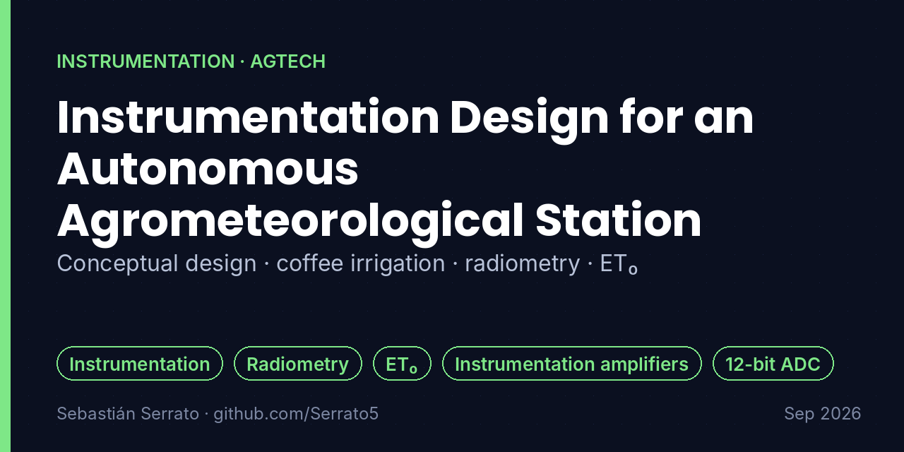
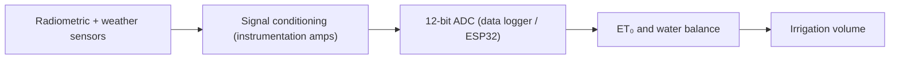

# Instrumentation Design for an Autonomous Agrometeorological Station

**Conceptual design · coffee irrigation · radiometry · ET₀**

`Instrumentation` `Radiometry` `ET₀` `Instrumentation amplifiers` `12-bit ADC` `ESP32`

## Overview

Conceptual design of the sensor scheme for an autonomous agrometeorological station aimed at optimizing irrigation in coffee crops.

> **Scope:** this was a conceptual design and calculation project, not a built prototype.

## Key features

- **Sensor scheme:** Evaluation of radiometric technologies: pyranometers, PAR, UV and IR sensors.
- **Water balance:** Calculation of evapotranspiration (ET₀) and irrigation volumes from theoretical meteorological data.
- **Signal conditioning:** Proposal of passive conditioning with instrumentation amplifiers for accurate readings with 12-bit ADCs (e.g., data loggers or an ESP32).

## How it works

## What I learned

- Reading and comparing sensor datasheets for a real application.
- Connecting physical measurements to an agronomic decision (how much to irrigate).
- Sizing signal conditioning for the ADC resolution.

## Project context

| | |
|---|---|
| Context | Universidad Surcolombiana |
| Dates | Sep 2026 |
| Area | Instrumentation · AgTech |

## Resumen en español

Diseño conceptual de la instrumentación de una estación agrometeorológica autónoma para optimizar el riego en cultivos de café: evaluación de sensores radiométricos (piranómetro, PAR, UV, IR), cálculo de evapotranspiración (ET₀) y volúmenes de riego, y acondicionamiento de señal para ADC de 12 bits.

---

**About this repository:** the original source code and design files of this project were not preserved. This repository documents what was built, how it works and what I learned, based on my project records. It does not contain reconstructed code.

**Sobre este repositorio:** el código y los archivos originales de este proyecto no se conservaron. Aquí se documenta qué se construyó, cómo funciona y qué aprendí, sin código reconstruido.

**Author:** Sebastián Serrato Ramírez · Electronic Engineering student, Universidad Surcolombiana (Neiva, Colombia) · [LinkedIn](https://www.linkedin.com/in/sebaserrato) · [More projects](https://github.com/Serrato5)
